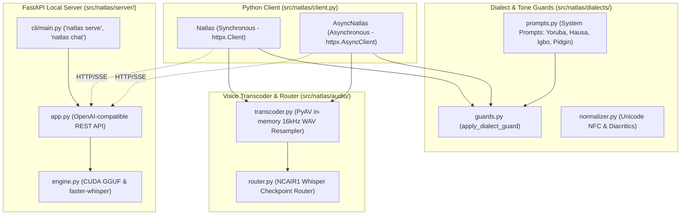

# natlas (Python SDK & Engine)

[](https://python.org)
[](https://opensource.org/licenses/MIT)
[](https://pypi.org)

The official Python SDK and local serving runtime for **N-ATLAS** (Nigeria's sovereign multilingual Large Language Model and Automatic Speech Recognition system).

Built for the **National AI Innovation Challenge (NAIC 2026)** by NCAIR and NITDA under **Problem Statement 01: Developer Infrastructure** (Track B: Innovation & Enterprise).

---

## Architecture



---

## Features

- **Dual Client Architecture**: Both synchronous (`Natlas`) and asynchronous (`AsyncNatlas`) clients with identical API surfaces via `httpx`.
- **Dialect Guards & Tone Integrity**: Automatic system prompt injection preventing language drift back to English for **Yorùbá, Hausa, Igbo, and Nigerian Pidgin**.
- **Turnkey Audio Transcoding (PyAV)**: In-memory transcoding of WhatsApp voice notes (`.ogg`, `.opus`), browser recordings (`.webm`), and mobile audio to 16kHz mono WAV in pure Python—no system `ffmpeg.exe` installation required.
- **Unified ASR Router**: Directly routes voice inputs to the official `NCAIR1` Whisper checkpoints (`Yoruba-ASR`, `Hausa-ASR`, `Igbo-ASR`, `NigerianAccentedEnglish`).
- **OpenAI-Compatible Local Engine**: Run `natlas serve` to spin up a local FastAPI server with CUDA GPU acceleration on consumer hardware (such as RTX 3060).

---

## Installation

### Client SDK (Lightweight)
```bash
# Using uv (Recommended)
uv add natlas

# Using pip
pip install natlas
```

### With Voice / Audio Transcoding
```bash
# Using uv (Recommended)
uv add "natlas[audio]"

# Using pip
pip install "natlas[audio]"
```

### With Local GPU Serving Engine
```bash
# Using uv (Recommended)
uv add "natlas[server]"

# Using pip
pip install "natlas[server]"
```

---

## Quickstart

### Multilingual Chat Completion
```python
from natlas import Natlas

client = Natlas(base_url="http://127.0.0.1:8000/v1")

# Chat with dialect enforcement
response = client.chat.create(
    language="yoruba",
    tone_enforcement=True,
    messages=[
        {"role": "user", "content": "Bawo ni mo se le se iforukọsilẹ ile-iṣẹ mi?"}
    ],
)

print(response.choices[0].message.content)
```

### Streaming Tokens in Real Time
```python
for chunk in client.chat.stream(
    language="hausa",
    messages=[{"role": "user", "content": "Barka dai!"}],
):
    print(chunk.choices[0].delta.content or "", end="", flush=True)
```

### Voice Note Transcription
```python
result = client.audio.transcribe(
    file="whatsapp_note.ogg",
    language="yoruba",
    transcode=True,
)
print("Transcription:", result.text)
print("Model:", result.model)
```

---

## Local Serving CLI

Launch the local inference server offloading GGUF layers to your CUDA GPU:

```bash
# Using uv (Recommended)
uv run natlas serve --model ./models/N-ATLaS.Q4_K_M.gguf --gpu-layers 32 --port 8000

# Using pip / global environment
natlas serve --model ./models/N-ATLaS.Q4_K_M.gguf --gpu-layers 32 --port 8000
```

Start interactive terminal chat:
```bash
# Using uv (Recommended)
uv run natlas chat --language yoruba

# Using pip
natlas chat --language yoruba
```

---

## Testing & Verification

```bash
# Run tests
uv run pytest tests/

# Lint and type check
uv run ruff check .
uvx ty check src
uvx pyrefly check src
```
