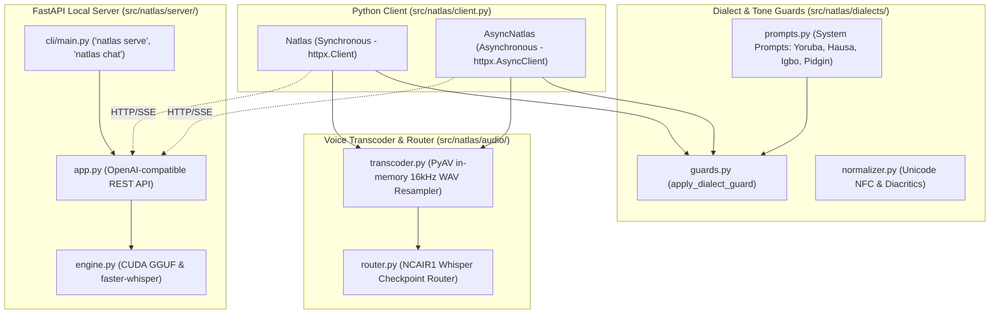

# natlas (Python SDK & Engine)

[](https://python.org)
[](https://opensource.org/licenses/MIT)
[](https://pypi.org)

The official Python SDK and local serving runtime for **N-ATLAS** (Nigeria's sovereign multilingual Large Language Model and Automatic Speech Recognition system).

Built for the **National AI Innovation Challenge (NAIC 2026)** by NCAIR and NITDA under **Problem Statement 01: Developer Infrastructure** (Track B: Innovation & Enterprise).

---

## Architecture



---

## Features

- **Dual Client Architecture**: Both synchronous (`Natlas`) and asynchronous (`AsyncNatlas`) clients with identical API surfaces via `httpx`.
- **Dialect Guards & Tone Integrity**: Automatic system prompt injection preventing language drift back to English for **Yorùbá, Hausa, Igbo, and Nigerian Pidgin**.
- **Turnkey Audio Transcoding (PyAV)**: In-memory transcoding of WhatsApp voice notes (`.ogg`, `.opus`), browser recordings (`.webm`), and mobile audio to 16kHz mono WAV in pure Python—no system `ffmpeg.exe` installation required.
- **Unified ASR Router**: Directly routes voice inputs to the official `NCAIR1` Whisper checkpoints (`Yoruba-ASR`, `Hausa-ASR`, `Igbo-ASR`, `NigerianAccentedEnglish`).
- **OpenAI-Compatible Local Engine**: Run `natlas serve` to spin up a local FastAPI server with CUDA GPU acceleration on consumer hardware (such as RTX 3060).

---

## Installation

### Track A: Python Client SDK (Lightweight & Pure Python)
For application developers connecting to an existing N-ATLAS server or hosted API endpoint. Installs in seconds with **zero C++ compilers or heavy GPU dependencies**:

```bash
# Using uv (Recommended)
uv add n-atlas

# Using pip
pip install n-atlas
```

Optional audio transcoding (PyAV in-memory WhatsApp/browser audio resampler):
```bash
uv add "n-atlas[audio]"
# or: pip install "n-atlas[audio]"
```

---

### Track B: Local Sovereign Serving Engine (Hardware-Accelerated)
For developers running the 8B LLM and ASR models locally on their own workstation or GPU server.

#### 1. Clone & Synchronize
```bash
git clone https://github.com/your-org/n-atlas.git
cd n-atlas/natlas-python
uv sync
```

#### 2. One-Command Hardware Bootstrap (Automated)
Run `natlas setup` to automatically detect your operating system and GPU, verify Hugging Face authentication, and install the matching pre-compiled acceleration binary:

```bash
uv run natlas setup
```

#### 3. Manual Installation (Alternative)
If you prefer installing pre-compiled wheels directly without CMake or Visual Studio C++ compilers:

* **Windows (NVIDIA GPU / CUDA 12.x & 13.x):**
  ```bash
  uv pip install llama-cpp-python --extra-index-url https://abetlen.github.io/llama-cpp-python/whl/cu124
  ```

* **macOS (Apple Silicon Metal) or CPU-only:**
  ```bash
  uv pip install llama-cpp-python --extra-index-url https://abetlen.github.io/llama-cpp-python/whl/cpu
  ```

---

## Quickstart

### Multilingual Chat Completion
```python
from natlas import Natlas

client = Natlas(base_url="http://127.0.0.1:8000/v1")

# Chat with dialect enforcement
response = client.chat.create(
    language="yoruba",
    tone_enforcement=True,
    messages=[
        {"role": "user", "content": "Bawo ni mo se le se iforukọsilẹ ile-iṣẹ mi?"}
    ],
)

print(response.choices[0].message.content)
```

### Streaming Tokens in Real Time
```python
for chunk in client.chat.stream(
    language="hausa",
    messages=[{"role": "user", "content": "Barka dai!"}],
):
    print(chunk.choices[0].delta.content or "", end="", flush=True)
```

### Voice Note Transcription
```python
result = client.audio.transcribe(
    file="whatsapp_note.ogg",
    language="yoruba",
    transcode=True,
)
print("Transcription:", result.text)
print("Model:", result.model)
```

---

## Local Serving CLI

### Pull Sovereign Weights (Ollama-style)
```bash
# Pull 4-bit quantized N-ATLAS LLM (~4.9 GB)
uv run natlas pull n-atlas:q4

# Pull all 4 sovereign speech models (Yorùbá, Hausa, Igbo, English)
uv run natlas pull asr
```

### Launch Inference Server
Launch the local OpenAI-compatible inference server. If weights or GPU wheels are missing, `natlas serve` will prompt to acquire them automatically:

```bash
# GPU acceleration (32 layers offloaded to CUDA)
uv run natlas serve --gpu-layers 32 --port 8000

# Automated / non-interactive bootstrap (CI or Docker)
uv run natlas serve --gpu-layers 32 --yes

# Lightweight mock mode (no weights loaded)
uv run natlas serve --mock
```

### Interactive Terminal Chat
```bash
uv run natlas chat --language yoruba
```

---

## Testing & Verification

```bash
# Run tests
uv run pytest tests/

# Lint and type check
uv run ruff check .
uvx ty check src
uvx pyrefly check src
```
